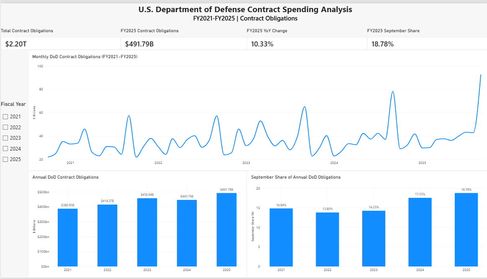

# U.S. Department of Defense Contract Spending Analysis

## Project Overview

This project analyzes U.S. Department of Defense contract obligations from fiscal years 2021 through 2025 using federal spending data from USAspending.gov.

The goal was to build an end-to-end data analysis workflow that moves from public API data collection through data transformation, SQL analysis, and interactive business intelligence reporting. The analysis focuses on spending trends over time, contractor and industry concentration, geographic distribution, competition, and the concentration of contract obligations near the end of the federal fiscal year.

The project uses Python and pandas for data collection and transformation, SQLite and SQL for structured analysis, and Power BI with DAX for interactive reporting and visualization.

## Tools & Technologies

- **USAspending.gov API** — federal contract spending data
- **Python** — data retrieval and analysis
- **pandas** — data cleaning, transformation, and aggregation
- **SQLite** — relational storage for analysis
- **SQL** — aggregation, ranking, year-over-year analysis, and window functions
- **Power BI** — interactive dashboard development
- **DAX** — KPI calculations and filter-aware measures
- **Google Colab / Jupyter Notebook** — development and reproducible analysis environment

## Data & Methodology

### Data Source

Contract spending data was obtained from **USAspending.gov**, the U.S. government's public source for federal spending information.

The project used two complementary datasets:

1. **Transaction-level DoD contract data** for detailed exploratory analysis of contractors, awarding organizations, industries, recipient locations, and competition.
2. **Monthly DoD contract obligations for FY2021–FY2025** for multi-year trend analysis and Power BI reporting.

The monthly dataset contains **60 observations**, representing 12 fiscal months for each of five fiscal years.

### Data Collection & Preparation

Python was used to request and process USAspending data. pandas was then used to:

- inspect and validate downloaded data;
- select fields relevant to the analysis;
- convert and clean numeric and date fields;
- aggregate contract obligations by contractor, agency, NAICS industry, state, and competition category;
- construct fiscal-year and fiscal-month fields;
- calculate annual totals and monthly shares; and
- export cleaned reporting datasets for downstream analysis.

The reporting dataset was validated for row completeness and contained all **60 expected monthly observations** with populated date, fiscal year, and contract obligation fields.

### SQL Analysis

The cleaned monthly data was loaded into a SQLite database for structured analysis.

SQL was used to calculate:

- annual contract obligation totals;
- year-over-year changes;
- fiscal-year rankings;
- monthly shares of annual obligations;
- September obligations by fiscal year;
- fiscal-year monthly averages; and
- September obligations relative to the average month.

The analysis used SQL techniques including `GROUP BY`, common table expressions (CTEs), and window functions such as `SUM() OVER()`, `AVG() OVER()`, `LAG()`, `RANK()`, and `ROW_NUMBER()`.

A reusable SQL view was created as the reporting layer for the Power BI dataset.

### Power BI & DAX

A Power BI dashboard was developed from the SQL-prepared reporting data to communicate the major spending trends and findings.

The dashboard includes:

- total contract obligations across FY2021–FY2025;
- FY2025 contract obligations;
- FY2025 year-over-year change;
- FY2025 September share of annual obligations;
- a five-year monthly obligations trend;
- annual obligation comparisons;
- September concentration by fiscal year; and
- an interactive fiscal-year slicer.

DAX measures were used for KPI calculations and to control filter context so that fixed FY2025 and five-year headline metrics remain consistent while supporting charts respond interactively to fiscal-year selections.

## Key Findings

### Five-Year Spending Trend

- DoD contract obligations totaled approximately **$2.20 trillion** across FY2021–FY2025.
- Annual obligations increased from **$386.95 billion in FY2021** to **$491.79 billion in FY2025**, an increase of approximately **27.1%** across the period.
- FY2025 recorded the highest annual obligations of the five fiscal years analyzed.
- Annual obligations increased **10.33% from FY2024 to FY2025**, following a **2.45% decline from FY2023 to FY2024**.

### Fiscal Year-End Concentration

- **September was the highest-obligation month in every fiscal year** from FY2021 through FY2025.
- September obligations increased from **$57.43 billion in FY2021** to **$92.35 billion in FY2025**.
- September represented **14.84% of FY2021** obligations and **18.78% of FY2025** obligations.
- FY2025 September obligations were **2.25 times the average FY2025 monthly obligation**, compared with 1.78 times the monthly average in FY2021.
- The results indicate that fiscal-year-end obligation concentration was particularly pronounced in FY2024 and FY2025.

### Contractor Concentration — Transaction-Level Sample

Analysis of the transaction-level dataset showed substantial concentration among large contractors:

- **Lockheed Martin** represented approximately **15.30%** of obligations in the analyzed transaction-level sample.
- The **top five parent contractors accounted for 42.35%** of obligations.
- The **top 10 accounted for 55.24%**.
- The **top 25 accounted for 68.67%**.
- The **top 50 accounted for 77.40%**.

### Industry & Geographic Concentration — Transaction-Level Sample

- Health and medical insurance carriers represented the largest NAICS category in the analyzed sample at approximately **18.81%** of obligations.
- Aircraft manufacturing represented approximately **13.48%**, while nonscheduled chartered passenger air transportation represented approximately **10.09%**.
- California was the largest recipient state in the analyzed sample at approximately **18.68%** of obligations.
- The top 10 recipient states collectively accounted for approximately **70.26%** of obligations.

### Competition — Transaction-Level Sample

- Approximately **90.27% of transactions by count** fell into competed categories.
- Those competed transactions represented approximately **61.40% of obligation dollars**.
- Transactions classified as not competed represented approximately **8.57% of transactions by count** but **31.95% of obligation dollars**.
- This difference shows that transaction frequency and dollar concentration can produce substantially different views of competition within the analyzed sample.

## Project Structure

```text
DoD_Contract_Spending_Analysis/
│
├── DoD_Contract_Spending_Analysis.pbix
│   └── Interactive Power BI dashboard
│
├── DoD_Contract_Spending_Analysis.ipynb
│   └── Python, pandas, API, and SQL analysis workflow
│
├── dod_contract_analysis.db
│   └── SQLite database used for SQL analysis and reporting views
│
├── dod_monthly_contract_obligations_2021_2025.csv
│   └── Cleaned monthly DoD contract obligations dataset
│
├── powerbi_monthly_contracts.csv
│   └── Reporting dataset prepared for Power BI
│
└── README.md
    └── Project documentation
```

## Limitations

- The five-year trend analysis uses monthly aggregate contract obligation data and therefore does not provide transaction-level detail for every contract action during FY2021–FY2025.
- Detailed contractor, industry, geographic, and competition findings were derived from the transaction-level sample used during exploratory analysis and should not be interpreted as five-year market shares.
- Contract obligations represent federal commitments and should not be interpreted as equivalent to cash outlays or payments made during the same period.
- Negative transaction obligations can occur because of deobligations, corrections, or other award modifications.
- The analysis identifies patterns and associations in reported spending data but does not establish causal explanations for changes in contract obligations or fiscal-year-end concentration.

## Dashboard

The Power BI dashboard provides an interactive view of DoD contract spending trends across FY2021–FY2025, including annual totals, year-over-year change, monthly spending patterns, and September concentration.

Users can filter supporting charts by fiscal year while headline KPIs provide consistent five-year and FY2025 reference points.